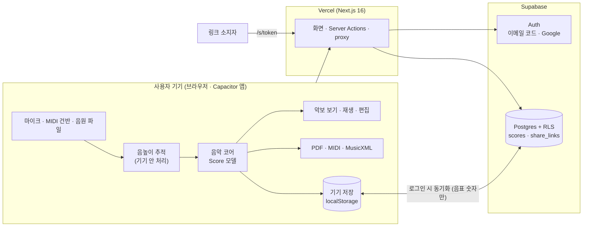
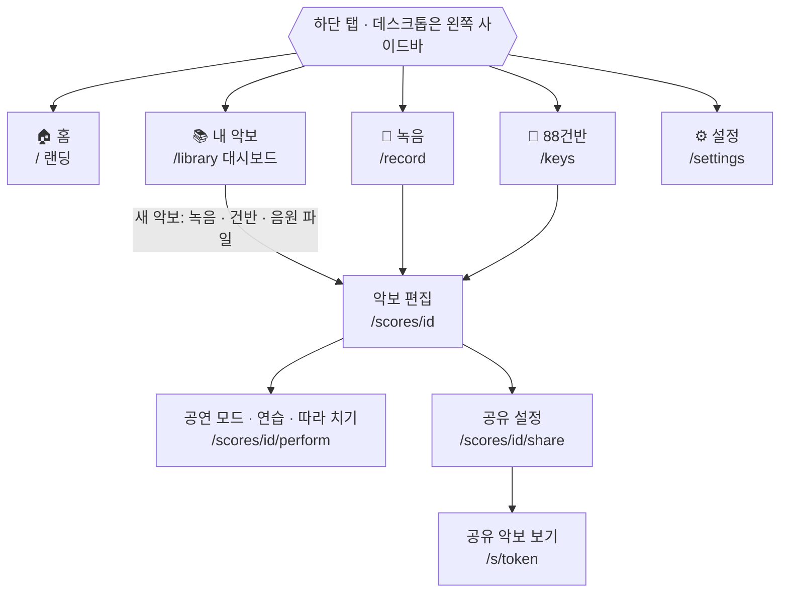
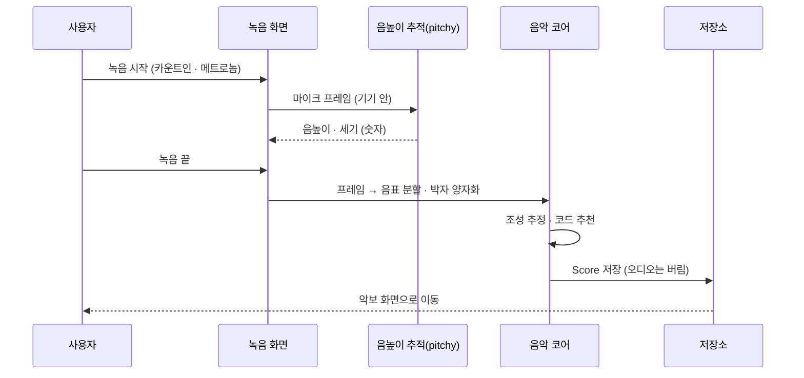

# HumScore — 허밍으로 만드는 악보

흥얼거리면 악보가 되고, 원클릭으로 전조하고, 코드 악보·피아노 악보·MIDI·MusicXML·PDF로 내보내는 앱입니다.
웹·iOS·Android를 한 코드베이스로 만듭니다(Next.js 16 + Supabase + Capacitor 8).

| 바로가기 | 주소 |
|---|---|
| 🌐 운영 서비스 | https://humscore.vercel.app |
| 💻 GitHub 저장소 | https://github.com/DevOps0906/humscore |
| 🐞 이슈·피드백 | https://github.com/DevOps0906/humscore/issues |
| ⚙️ CI 실행 기록 | https://github.com/DevOps0906/humscore/actions |
| 📋 작업 목록 | [tasks/README.md](tasks/README.md) · 지금 상태 [tasks/NOW.md](tasks/NOW.md) |

## 목차

| 장 | 내용 |
|---|---|
| [1. 기획 요약](#1-기획-요약) | 한 줄 정의 · 사용자 · 범위 · 수익 모델 · 설계 원칙 |
| [2. 기술 스택](#2-기술-스택) | 영역별 기술 |
| [3. 구조도](#3-구조도) | 시스템 구성 · 화면 이동 · 허밍→악보 흐름 · 다이어그램 파일 |
| [4. 랜딩페이지 디자인 구조](#4-랜딩페이지-디자인-구조) | 섹션 순서 · 반응형 3구간 · 시안 파일 |
| [5. 진행 현황](#5-진행-현황-2026-11-03-기준) | 완성도(%) · 개발 단계 · 영역별 · 웨이브별 |
| [6. 추후 개발 예정](#6-추후-개발-예정) | 우선순위별 다음 작업 |
| [7. 빠른 시작](#7-빠른-시작) | 로컬 · Docker · 앱 실행 |
| [8. 폴더 구조](#8-폴더-구조) | 소스 디렉터리 |
| [9. 콘텐츠 바로가기](#9-콘텐츠-바로가기) | 화면 ↔ 기획 문서 ↔ 코드 |
| [10. 관련 문서·GitHub](#10-관련-문서github) | 기획 · 명세 · ADR · CI 링크 |
| [11. 실기기 테스트 체크리스트](#11-실기기-테스트-체크리스트) | 휴대폰 확인 항목 |

## 1. 기획 요약

| 항목 | 내용 |
|---|---|
| 한 줄 정의 | 흥얼거리면 악보가 되는 앱 — 한국어 · 가입 없이 · 목소리는 기기 밖으로 나가지 않음 |
| 포지셔닝 | "허밍 앱 중 가장 믿을 만한 악보 — 목소리는 기기에만 남고, 바로 고치고, 바로 연주한다" |
| 상세 문서 | [PRD](docs/01_PRD.md) · [화면 기획](docs/03_SCREENS_UX.md) · [데이터 모델](docs/05_DATA_MODEL.md) · [경쟁 분석](docs/07_COMPETITORS.md) |

### 사용자와 핵심 시나리오

| # | 사용자 | 하고 싶은 일 | 성공 상태 |
|---|---|---|---|
| S1 | 개인 허밍 작곡자 | 떠오른 멜로디를 흥얼거려 악보로 남기고 전조·수정 | 첫 악보를 가입 없이 완성하고 저장 |
| S2a | 찬양 인도자 | 내 악보로 예배 콘티를 짜고 팀에 공유·인쇄 | 콘티 링크 하나로 팀원 준비 완료 |
| S2b | 찬양팀·성가대 팀원 | 인도자가 보낸 콘티와 악보를 키·순서대로 연주 | 링크로 읽기 전용 열람, 공연 모드로 연주 |
| S3 | 피아노 독학자 | 듣고 싶은 곡 선율을 느리게·구간 반복해 연습 | 구간 반복·속도 조절로 곡을 익힘 |

### 기능 범위와 상태

| 우선 | 기능 | 상태 |
|---|---|---|
| P0 | 허밍 → 악보 · 빠른 패시지 인식 | ✅ 구현 · 실기기 조정 대기 |
| P0 | 앱 PDF 내보내기 · 클라우드 동기화 | ✅ 구현 |
| P0 | 랜딩 개편(단일 CTA · 실제 데모) | ✅ 구현 |
| P1 | 구간 반복 · 재생 속도 · 따라 치기 | ✅ 구현 |
| P1 | 읽기 전용 공유 링크 | ✅ 구현 · 운영 적용 |
| P1 | 설정(운영·관리 화면) | 🔨 개발 중 |
| P1 | 찬양 콘티(세트리스트) | ⏳ 예정 |
| P1 | 내 악보 검색·폴더·태그 | 🔸 검색만 구현 |
| P1 | 가격 안내 · Pro 결제 · 앱 스토어 출시 | ⏳ 예정 |
| P2 | 반주 섞인 음원 → 멜로디 악보 | 🧪 실험 중(task-004) |
| P2 | 유튜브 링크 → 악보(탭 캡처) | ⏳ 예정 · [ADR 0001](docs/adr/0001-youtube-tab-capture.md) |
| P2 | 자동 반주 · 장르 스타일 | ⏳ 예정 |

### 수익 모델

| 플랜 | 가격 | 포함 |
|---|---|---|
| 무료 | 0원 | 허밍 → 악보 전체, 전조·재생, 가입 없이 기기 저장 |
| Pro(안) | 월 4,900~6,900원 | 클라우드 보관·동기화, 공유 링크, 내보내기, 검색·폴더, 음원 변환 |

### 설계 원칙

| # | 원칙 | 의미 |
|---|---|---|
| 1 | 화면은 Next.js, 데이터는 Supabase(RLS) | 서버 코드는 Server Actions·Route Handler·proxy에만. 마이크 화면은 클라이언트 컴포넌트 |
| 2 | 하나의 악보 모델(`Score`), 여러 뷰 | 모든 출력은 `Score` → MusicXML/MIDI 변환 |
| 3 | 전조는 데이터를 바꾸지 않음 | `transpose` 값만 저장하고 출력 때 적용 → 원키로 언제든 복귀 |
| 4 | 목소리는 저장·전송하지 않음 | 마이크 음성은 기기 안에서 음표 숫자로만 변환 |
| 5 | 라이선스 안전 스택만 | 새 의존성은 MIT·ISC·BSD·Apache-2.0만 |

## 2. 기술 스택

| 영역 | 선택 | 위치 |
|---|---|---|
| 웹·서버 | Next.js 16.4(App Router·Server Actions) · React 19 · TypeScript · Tailwind CSS v4 · shadcn/ui | `src/` |
| 앱 | Capacitor 8(운영 도메인 원격 로드) | `ios/` · `android/` |
| DB·인증 | Supabase(Postgres·RLS·Auth, `@supabase/ssr`) | `supabase/` |
| 음악 코어 | 순수 TypeScript(브라우저 의존 없음) | `src/lib/music/` |
| 오디오 | Web Audio · pitchy(MIT) · 배음 합성 피아노 | `src/lib/audio/` |
| 악보 렌더 | OpenSheetMusicDisplay(BSD-3) | `src/components/` |
| 배포·CI | Vercel(main → 운영 자동 배포) · GitHub Actions(CI · DB migrate) | `.github/workflows/` |
| 테스트 | Vitest(단위 668개) · Playwright(e2e, desktop + mobile) | `**/*.test.ts` · `e2e/` |

## 3. 구조도

### 시스템 구성



### 화면 이동 (하단 탭)



### 허밍 → 악보 흐름



### 다이어그램 파일

| 파일 | 내용 |
|---|---|
| [sitemap.mmd](docs/diagrams/sitemap.mmd) | 전체 화면 지도(권한별) |
| [screen-data.mmd](docs/diagrams/screen-data.mmd) | 화면 ↔ 데이터 테이블 |
| [share-link-sequence.mmd](docs/diagrams/share-link-sequence.mmd) | 공유 링크 발급·열람 순서 |
| [redesign-flow.mmd](docs/diagrams/redesign-flow.mmd) | 재디자인 화면 흐름 |
| [flow-F-L](docs/diagrams/flow-F-L.mmd) · [flow-F-S](docs/diagrams/flow-F-S.mmd) · [flow-F-C](docs/diagrams/flow-F-C.mmd) · [flow-F-Y](docs/diagrams/flow-F-Y.mmd) | 기능별 흐름(랜딩·공유·콘티·유튜브) |
| [youtube-capture-flow.mmd](docs/diagrams/youtube-capture-flow.mmd) | 유튜브 탭 캡처(예정) |

## 4. 랜딩페이지 디자인 구조

코드: [`src/app/(marketing)/page.tsx`](<src/app/(marketing)/page.tsx>) · 스타일: [`landing.module.css`](src/components/landing/landing.module.css) · 문구: [`data.ts`](src/components/landing/data.ts)

| 순서 | 섹션(id) | 제목 | 역할 |
|---|---|---|---|
| 1 | 히어로 | 허밍·건반 악보 변환 | 핵심 가치 + 단일 CTA(허밍 시작) + 휴대폰 목업 |
| 2 | 특징 띠 | HumScore 특징 | 숫자·키워드로 신뢰 요소 |
| 3 | `#how` | 세 단계면 충분합니다 | 사용 방법 3단계 |
| 4 | `#try` | 직접 경험해 보세요 | 실제 데모 |
| 5 | `#editor` | 받아 적은 악보를 바로 다듬으세요 | 편집 화면 소개 |
| 6 | `#products` | 멜로디를 악보로 만드는 도구 | 기능 카드 |
| 7 | `#features-flow` | 흥얼거림이 악보가 되기까지 | 입력 → 처리 → 보기 → 내보내기 흐름 |
| 8 | `#new` | 같은 악보를 더 많은 방식으로 | 신규 기능 |
| 9 | `#formats` | 즐겨 쓰는 프로그램에서 그대로 열립니다 | 호환 형식·프로그램 |
| 10 | `#why` | HumScore가 편한 이유 | 장점 |
| 11 | `#privacy` | 목소리는 기기 밖으로 나가지 않아요 | 개인정보 원칙 |
| 12 | `#pricing` | 가격 | 무료 / Pro 안내 |
| 13 | `#faq` | 자주 묻는 질문 | FAQ |
| 14 | `#close` | 오늘 떠오른 멜로디, 지금 악보로. | 마지막 CTA |

| 반응형 구간 | 폭 | 배치 |
|---|---|---|
| 모바일 | ~767px | 1열 · 하단 탭바 · 히어로 세로 |
| 태블릿 | 768~1199px | 2열 카드 · 하단 탭바 · 히어로 세로 |
| 데스크톱 | 1200px~ | 다열 카드 · 왼쪽 사이드바(앱 화면) · 히어로 가로 |

| 디자인 자료 | 파일 |
|---|---|
| 랜딩 시안 | [redesign-landing.html](docs/design/redesign-landing.html) · [v2](docs/design/redesign-landing-v2.html) · [미리보기](docs/design/landing-preview.html) |
| 내 악보 시안 | [redesign-library.html](docs/design/redesign-library.html) |
| UX 메모 · 벤치마크 | [redesign-ux.md](docs/design/redesign-ux.md) · [08_REDESIGN_BENCHMARK](docs/08_REDESIGN_BENCHMARK.md) |
| 디자인 토큰(정답) | [`src/app/globals.css`](src/app/globals.css) `@theme` |

## 5. 진행 현황 (2026-11-03 기준)

웹 MVP(허밍 → 악보 → 편집·재생·내보내기·동기화·공유)는 운영(https://humscore.vercel.app)에 배포돼 있습니다. 남은 큰 일은 **실기기 확인**과 **반주 섞인 음원 → 멜로디 악보**입니다.

### 전체 완성도

| 구분 | 완성도 | 근거 |
|---|---|---|
| **작업 표 기준** | **75%** (15 / 20) | [`tasks/README.md`](tasks/README.md) 완료 개수, 가중치 없음 |
| **웹 MVP 기능** | **약 90%** | 아래 영역별 표의 웹 기능 평균(추정) |
| **앱 출시 준비** | **약 40%** | 실기기 체크리스트·스토어 등록 미수행 |

### 개발 단계 (SDLC)

| 단계 | 상태 | 완성도 |
|---|---|---|
| 1. 기획(PRD·화면·데이터 모델) | 완료 | 100% |
| 2. 디자인(토큰·랜딩·내 악보 재디자인) | 완료 | 100% |
| 3. 핵심 구현(입력·편집·재생·내보내기) | 완료 | 100% |
| 4. 서버·동기화(Supabase RLS·공유 링크) | 완료 · 운영 DB 적용 | 100% |
| 5. 자동 테스트(unit 668 · e2e) | 진행 | 90% |
| 6. 배포(Vercel·GitHub CI) | 운영 배포 중 · DB 자동 반영용 Secrets 미등록 | 80% |
| 7. 실기기 확인(iOS·Android) | 사용자 확인 시작 | 10% |
| 8. 음원 → 멜로디 악보(task-004·011) | 실험 2단계 진행 | 40% |
| 9. 앱 스토어 출시 | 시작 전 | 0% |

### 영역별 완성도

| 영역 | 완성도 | 현재 상태 |
|---|---|---|
| 허밍·건반 입력 → 악보 | 90% | 구현 · 빠른 패시지 상수는 실기기 조정 대기(task-008) |
| 편집(셈여림·도돌이표·가사)·전조·내보내기(PDF·MIDI·MusicXML) | 100% | 구현 |
| 재생·연습(속도·구간 반복)·따라 치기 | 90% | 구현 · 판정 임계값 실기기 조정 대기(task-016) |
| 클라우드 동기화(Supabase RLS·LWW) | 100% | 구현 · 통합 검증(task-012) · 로컬 OTP 로그인 e2e |
| 읽기 전용 공유 링크(`/s/[token]`) | 100% | 구현(task-019) · 운영 DB 적용(2026-11-03) |
| 내비게이션(하단 탭 홈·내 악보·녹음·88건반·설정) | 80% | 홈(랜딩) 탭·내 악보 → 음원 파일 완료, 설정 탭 개발 중 |
| 설정(계정·동기화·마이크 점검·기본값·공유 링크·도움말) | 개발 중 | 운영·관리 화면 |
| 음원 파일 → 음표(악기 하나) | 100% | 편집 화면·내 악보에서 MP3·WAV 업로드 |
| 반주 섞인 음원 → 멜로디(task-004) | 40% | 1단계 멜로디 추적 후처리, 2단계 음원 분리 실험 — 청취 판정 대기 |
| 외부 소리 실시간 받아 적기(task-011) | 0% | task-004 결과 대기 · 같은 휴대폰 재생 캡처는 OS 제약으로 불가 |
| 앱(iOS·Android) | 40% | Capacitor 원격 로드 · 실기기 체크리스트 미수행 |

### 웨이브별 작업 진행률

| 웨이브 | 완료 / 전체 | 진행률 | 남은 작업 |
|---|---|---|---|
| W0 준비 | 1 / 1 | 100% | — |
| W1 기본 기능·정리 | 7 / 8 | 88% | task-005 실기기 체크리스트(사용자) |
| W2 핵심 기능 | 6 / 8 | 75% | task-014 실기기 상수 조정, task-016 실기기 결과 반영 |
| W3 음원 변환 | 1 / 3 | 33% | task-004(재개, 실험 중), task-011(task-004 대기) |
| **합계** | **15 / 20** | **75%** | |

제한: 로그인은 체험용 자동 로그인(`NEXT_PUBLIC_AUTH_MOCK`)이 기본입니다. 운영 Supabase는 무료 플랜이라 오래 안 쓰면 일시 정지됩니다(대시보드에서 Restore).

## 6. 추후 개발 예정

| 순서 | 할 일 | 상태 | 담당 |
|---|---|---|---|
| 1 | 설정 화면(계정·동기화·마이크 점검·기본값·공유 링크·도움말) | 🔨 개발 중 | 팀 |
| 2 | 실기기 체크리스트 → 판정·카운트인 상수 조정(task-005·016) | ⏳ 사용자 확인 대기 | 사용자 → 팀 |
| 3 | 반주 섞인 음원 → 멜로디: 1·2단계 결과 청취 판정 → 본 구현 결정(task-004) | ⏳ 사용자 판정 대기 | 사용자 |
| 4 | 외부 소리 실시간 받아 적기(task-011) | ⏳ task-004 대기 | 팀 |
| 5 | GitHub Secrets 등록 → DB 자동 반영 | ⏳ | 사용자 |
| 6 | 찬양 콘티(세트리스트) — 공유 링크 재사용 | ⏳ 다음 기능 | 팀 |
| 7 | 내 악보 폴더·태그 | ⏳ | 팀 |
| 8 | 가격 안내 · Pro 결제 | ⏳ | 팀 |
| 9 | 앱 스토어 출시(iOS·Android) | ⏳ | 팀 |
| 10 | 유튜브 링크 → 악보(탭 캡처) · 자동 반주 | ⏳ P2 | 팀 |

## 7. 빠른 시작

```bash
npm install
npm run dev          # http://localhost:3100  (마이크는 localhost 또는 https에서만 동작)
npm test             # Vitest 단위 테스트
npm run test:e2e     # Playwright E2E (로컬 프로덕션 빌드, desktop + mobile)
E2E_BASE_URL=https://humscore.vercel.app npm run test:e2e   # 운영 배포본 대상
```

환경변수(`.env.local`): `NEXT_PUBLIC_SUPABASE_URL`, `NEXT_PUBLIC_SUPABASE_PUBLISHABLE_KEY` — 없으면 로컬 저장 모드로 동작.
`vercel env pull`로 받을 수 있습니다. Supabase Auth Redirect URLs에 `<도메인>/auth/callback`을 등록하세요.

### Docker로 실행

```bash
docker compose up -d           # 빌드 후 백그라운드 실행 → http://localhost:3200
docker compose up -d --build   # 코드 변경 후 다시 빌드
docker compose logs -f web     # 로그 보기
docker compose down            # 중지
```

- 접속 주소: **http://localhost:3200** (컨테이너 내부 3000 → 호스트 3200. 3100은 `npm run dev` 기본 포트와 겹치지 않게 비워 둠)
- Supabase 로그인·동기화를 켜려면 프로젝트 루트 `.env`에 `NEXT_PUBLIC_SUPABASE_URL`·`NEXT_PUBLIC_SUPABASE_PUBLISHABLE_KEY`를 넣고 `--build`로 다시 빌드합니다(빌드 때 번들에 들어감). 비우면 이 기기 저장 모드로 동작합니다.
- 마이크는 localhost 또는 https에서만 동작하므로 같은 PC 브라우저에서 접속하세요.

### 앱으로 실행

```bash
npm run cap:android  # cap sync → Android Studio 열기
npm run cap:ios      # cap sync → Xcode 열기 (macOS 필요)
CAP_SERVER_URL=http://<PC IP>:3100 npx cap sync   # 실기기에서 개발 서버 라이브 리로드
```

앱은 `capacitor.config.ts`의 `server.url`(운영 도메인)을 불러오고, 연결 실패 시 `native-shell/index.html` 안내 페이지를 띄웁니다.
앱 웹뷰에서는 Google OAuth가 차단되므로 이메일 6자리 코드 로그인을 사용합니다.
플랫폼을 다시 만들었다면 `npx cap add android` 후 `npm run native:permissions`를 실행하세요.

## 8. 폴더 구조

```
src/
├── app/
│   ├── (marketing)/          # / 랜딩 (서버 컴포넌트)
│   ├── (auth)/login/         # 이메일 코드 · Google 로그인
│   ├── auth/callback/        # Supabase OAuth 코드 교환 (Route Handler)
│   ├── (app)/                # 앱 화면 (탭바)
│   │   ├── library/          # 내 악보 목록
│   │   ├── record/           # 녹음: 메트로놈 + 실시간 음정(Hz·센트) + 궤적
│   │   ├── keys/             # 88건반 입력
│   │   ├── settings/         # 설정: 계정·동기화·마이크 점검·기본값·공유 링크·도움말
│   │   └── scores/[id]/      # 악보 보기·편집·재생·전조·내보내기, perform/ 공연 모드
│   └── actions/              # Server Actions (악보 동기화, 로그아웃)
├── proxy.ts                  # Supabase 세션 쿠키 갱신
├── components/               # 공유 컴포넌트 (ui/ = shadcn)
├── hooks/
└── lib/
    ├── music/                # 순수 TypeScript 음악 코어 (UI·브라우저 의존 없음)
    ├── audio/                # Web Audio: 피치 추적(pitchy), 배음 합성 피아노, 메트로놈
    ├── platform/             # 웹/앱 차이 흡수 (파일 저장·공유 시트)
    └── storage/              # localStorage 기본 저장 + Supabase 동기화(병합·삭제 기록)
supabase/migrations/          # scores(RLS·소프트 삭제·LWW 트리거), transcription_jobs
e2e/                          # Playwright E2E
native-shell/                 # 앱 오프라인 안내 페이지
```

## 9. 콘텐츠 바로가기

| 콘텐츠 | 화면 경로 | 기획·명세 문서 | 구현 코드 |
|---|---|---|---|
| 랜딩 | `/` | [03_SCREENS_UX](docs/03_SCREENS_UX.md) L01 | [`src/app/(marketing)/page.tsx`](<src/app/(marketing)/page.tsx>) |
| 녹음(허밍) | `/record` | [03_SCREENS_UX](docs/03_SCREENS_UX.md) R01 | [`src/app/(app)/record/`](<src/app/(app)/record/>) |
| 건반 입력 | `/keys` | [03_SCREENS_UX](docs/03_SCREENS_UX.md) K01 | [`src/app/(app)/keys/`](<src/app/(app)/keys/>) |
| 내 악보 | `/library` | [03_SCREENS_UX](docs/03_SCREENS_UX.md) B01 | [`src/app/(app)/library/`](<src/app/(app)/library/>) |
| 악보 상세·편집 | `/scores/[id]` | [03_SCREENS_UX](docs/03_SCREENS_UX.md) E01 | [`src/app/(app)/scores/[id]/`](<src/app/(app)/scores/[id]/>) |
| 공연 모드·연습 | `/scores/[id]/perform` | [task-002 명세](docs/specs/task-002-perform-boost.md) | [`src/app/(app)/scores/[id]/perform/`](<src/app/(app)/scores/[id]/perform/>) |
| 따라 치기 | `/scores/[id]/perform` | [task-010 명세](docs/specs/task-010-follow-along.md) | [`src/lib/music/follow.ts`](src/lib/music/follow.ts) |
| 공유 설정 | `/scores/[id]/share` | [task-019 명세](docs/specs/task-019-share-link.md) · [04_API](docs/04_API.md) | [`src/app/(app)/scores/[id]/share/`](<src/app/(app)/scores/[id]/share/>) |
| 공유 악보 보기 | `/s/[token]` | [task-019 명세](docs/specs/task-019-share-link.md) | [`src/app/s/[token]/`](<src/app/s/[token]/>) |
| 음원 → 음표(스파이크) | — | [task-004 명세](docs/specs/task-004-audio-transcription.md) · [1차·재개 보고](docs/specs/task-004-spike-report.md) · [2단계 보고](docs/specs/task-004-spike2-report.md) | 브랜치 `spike/task-004` |
| 설정 | `/settings` | 이 README 5·6장 | [`src/app/(app)/settings/`](<src/app/(app)/settings/>) |
| 기획 문서 | — | [PRD](docs/01_PRD.md) · [데이터 모델](docs/05_DATA_MODEL.md) · [벤치마크](docs/06_BENCHMARK.md) · [경쟁 분석](docs/07_COMPETITORS.md) · [ADR 0001](docs/adr/0001-youtube-tab-capture.md) | — |
| 작업 목록 | — | [tasks/README.md](tasks/README.md) · [tasks/NOW.md](tasks/NOW.md) | — |

## 10. 관련 문서·GitHub

| 분류 | 링크 |
|---|---|
| GitHub | [저장소](https://github.com/DevOps0906/humscore) · [이슈](https://github.com/DevOps0906/humscore/issues) · [Actions(CI)](https://github.com/DevOps0906/humscore/actions) · [커밋 기록](https://github.com/DevOps0906/humscore/commits/main) |
| CI 워크플로 | [ci.yml](.github/workflows/ci.yml)(린트·타입·테스트·빌드) · [db-migrate.yml](.github/workflows/db-migrate.yml)(운영 DB 마이그레이션) |
| 기획 | [01 PRD](docs/01_PRD.md) · [03 화면 기획](docs/03_SCREENS_UX.md) · [04 API](docs/04_API.md) · [05 데이터 모델](docs/05_DATA_MODEL.md) |
| 조사 | [06 벤치마크](docs/06_BENCHMARK.md) · [07 경쟁 분석](docs/07_COMPETITORS.md) · [08 재디자인 벤치마크](docs/08_REDESIGN_BENCHMARK.md) |
| 기능 명세 | [task-002 공연 모드](docs/specs/task-002-perform-boost.md) · [task-010 따라 치기](docs/specs/task-010-follow-along.md) · [task-019 공유 링크](docs/specs/task-019-share-link.md) · [task-004 음원 변환](docs/specs/task-004-audio-transcription.md) |
| 실험 보고 | [task-004 1차·재개](docs/specs/task-004-spike-report.md) · [task-004 2단계](docs/specs/task-004-spike2-report.md) |
| 결정 기록 | [ADR 0001 유튜브 탭 캡처](docs/adr/0001-youtube-tab-capture.md) |
| DB | [마이그레이션](supabase/migrations/) |
| 에이전트 규칙 | [AGENTS.md](AGENTS.md) · [CLAUDE.md](CLAUDE.md) |

## 11. 실기기 테스트 체크리스트

| # | 기기 | 확인 항목 | 결과 |
|---|---|---|---|
| 1 | iPhone | 첫 녹음 시 마이크 권한 팝업 → 허용 후 음정 표시 | ⬜ |
| 2 | iPhone | 무음 모드 스위치를 켠 상태에서 재생 소리 | ⬜ |
| 3 | Android | 권한 거부 후 재요청 동작 | ⬜ |
| 4 | 공통 | 블루투스 이어폰 사용 시 박자 밀림 정도(유선 대비) | ⬜ |
| 5 | 저사양 Android | 16마디 악보 렌더 시간 | ⬜ |
| 6 | 태블릿 | 공연 모드 + 블루투스 페이지 넘김 페달 | ⬜ |
| 7 | 공통 | 따라 치기 판정 타이밍 · 빠른 패시지 인식 | ⬜ |
| 8 | 공통 | 말로 가사 입력 · 음원 등록(목소리 배제) | ⬜ |
| 9 | 공통 | 같은 휴대폰에서 음악 재생 + 녹음 → OS 제약으로 불가(확인됨) | ❌ |
